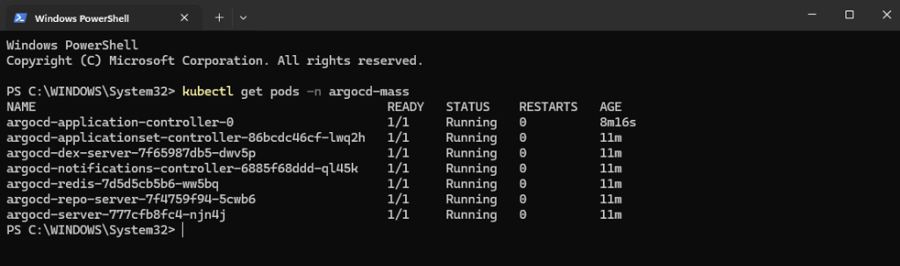
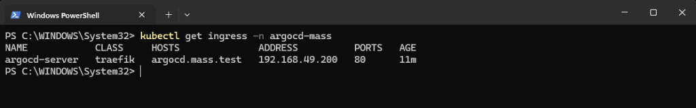
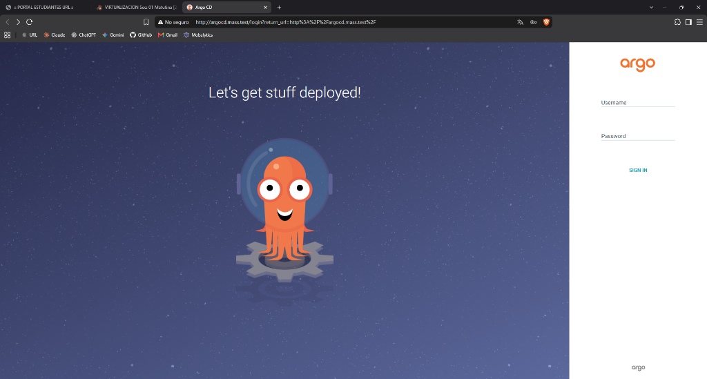
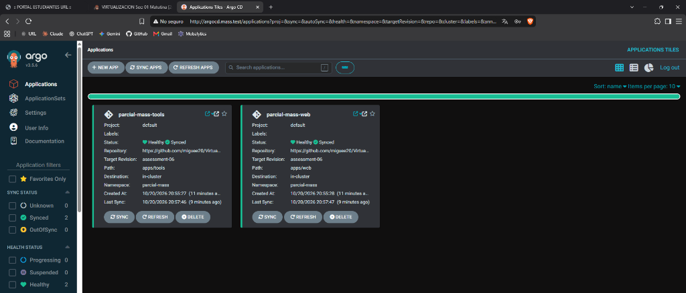
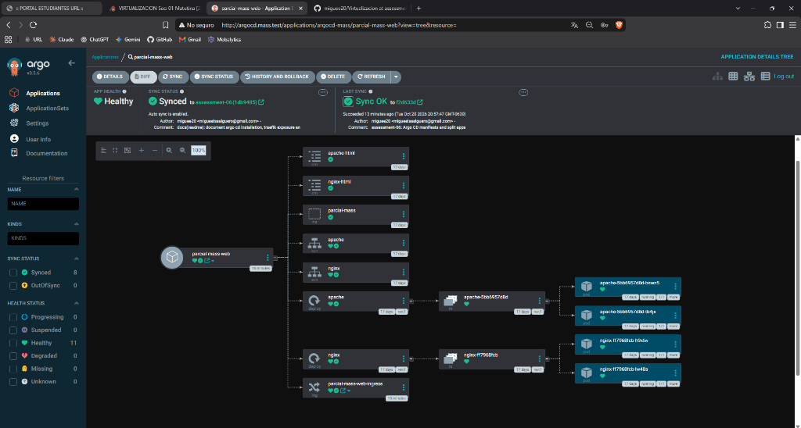
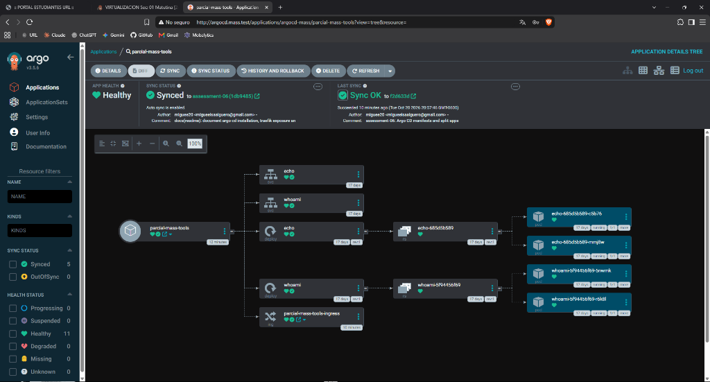
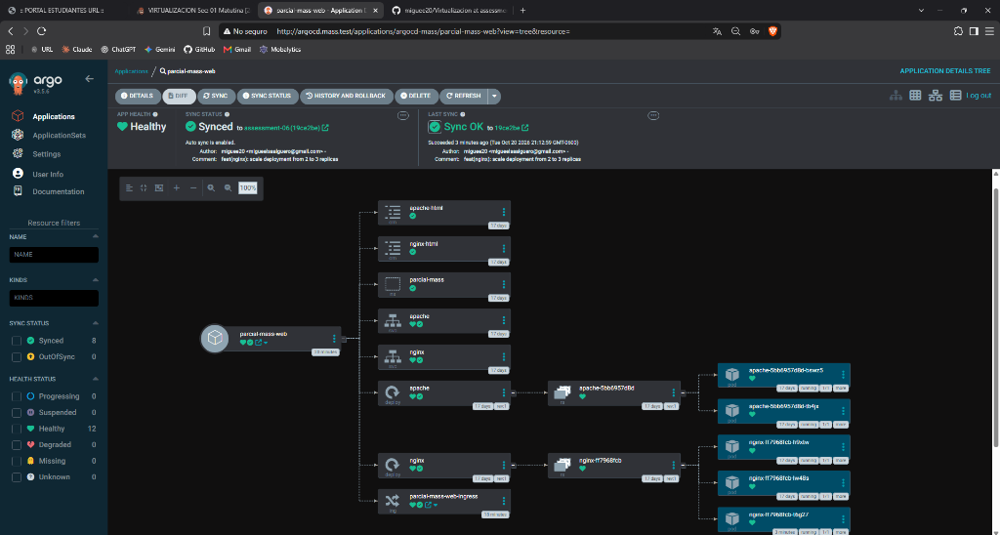

# Assessment 06 - Argo CD (GitOps)

**Student:** Miguel Antonio Salguero Sandoval (`mass`)

Argo CD is installed in Minikube in the `argocd-mass` namespace, exposed through Traefik at `http://argocd.mass.test`, and used to deploy the apps of the `parcial-mass` namespace from this repository (branch `assessment-06`) using two `Application` resources.

## Repository layout

- `metallb/`, `traefik/` - MetalLB and Traefik from Assessment II (unchanged)
- `argocd/install/` - Kustomize that installs Argo CD in `argocd-mass` + the Ingress for Traefik
- `argocd/applications/` - the two Argo CD `Application` definitions
- `apps/web/` - namespace, Nginx, Apache and their Ingress
- `apps/tools/` - Whoami, Echo and their Ingress
- `images/` - screenshots

## Step 1 - Start the cluster

```powershell
minikube start --driver=docker
kubectl get pods -A   # MetalLB and Traefik are running, Traefik EXTERNAL-IP = 192.168.49.200
```

## Step 2 - Install Argo CD in `argocd-mass`

`argocd/install/kustomization.yaml` takes the official manifest (pinned to `v3.5.6`) and:

- creates the `argocd-mass` namespace and installs everything in it,
- patches the `ClusterRoleBinding` subjects to the `argocd-mass` namespace (the official manifest hardcodes `argocd`, so without this the controller gets `forbidden` errors),
- sets `server.insecure: "true"` in `argocd-cmd-params-cm`, because Traefik talks plain HTTP to `argocd-server`.

```powershell
kubectl apply -k argocd/install --server-side --force-conflicts
kubectl rollout status deploy/argocd-server -n argocd-mass
kubectl get pods -n argocd-mass
```

`--server-side` is required because the Argo CD CRDs are too big for a client-side apply.

Initial admin password:

```powershell
kubectl -n argocd-mass get secret argocd-initial-admin-secret -o jsonpath="{.data.password}" | % { [Text.Encoding]::UTF8.GetString([Convert]::FromBase64String($_)) }
```



## Step 3 - Expose Argo CD through Traefik

`argocd/install/01-ingress.yaml` routes `argocd.mass.test` to the `argocd-server` service:

```yaml
apiVersion: networking.k8s.io/v1
kind: Ingress
metadata:
  name: argocd-server
  namespace: argocd-mass
  annotations:
    traefik.ingress.kubernetes.io/router.entrypoints: web
spec:
  ingressClassName: traefik
  rules:
    - host: argocd.mass.test
      http:
        paths:
          - path: /
            pathType: Prefix
            backend:
              service:
                name: argocd-server
                port:
                  number: 80
```

Hosts file (PowerShell as Administrator). As in Assessment II, with Docker driver on Windows the Traefik LoadBalancer (`192.168.49.200`) is reached through `minikube tunnel`, so the domain points to `127.0.0.1`:

```powershell
Add-Content C:\Windows\System32\drivers\etc\hosts "127.0.0.1 argocd.mass.test"
ipconfig /flushdns
minikube tunnel   # leave open, as Administrator
```

```powershell
kubectl get ingress -n argocd-mass
```



Argo CD login at http://argocd.mass.test (user `admin`):



## Step 4 - Applications

The repository was split in two folders, one per Application, both deploying to `parcial-mass`:

| Application | Path | Resources |
|---|---|---|
| `parcial-mass-web` | `apps/web` | namespace, Nginx, Apache, Ingress |
| `parcial-mass-tools` | `apps/tools` | Whoami, Echo, Ingress |

```yaml
apiVersion: argoproj.io/v1alpha1
kind: Application
metadata:
  name: parcial-mass-web
  namespace: argocd-mass
spec:
  project: default
  source:
    repoURL: https://github.com/miguee20/Virtualizacion.git
    targetRevision: assessment-06
    path: apps/web
  destination:
    server: https://kubernetes.default.svc
    namespace: parcial-mass
  syncPolicy:
    automated:
      prune: true
      selfHeal: true
    syncOptions:
      - CreateNamespace=true
```

`parcial-mass-tools` is identical except for the name and `path: apps/tools`. The repository is public, so Argo CD connects to it without credentials.

```powershell
kubectl apply -f argocd/applications/
kubectl get applications -n argocd-mass
kubectl get all,ingress -n parcial-mass
```

### Before the change (Synced / Healthy)







## Step 5 - Change in the repository

I changed the Nginx deployment replicas from `2` to `3` in `apps/web/01-nginx.yaml`, committed and pushed to `assessment-06`:

```powershell
git add apps/web/01-nginx.yaml
git commit -m "nginx: 3 replicas"
git push
```

Argo CD detected the new commit (automated sync, polls every ~3 minutes; it can be forced with Refresh) and applied it:

```powershell
kubectl get deploy nginx -n parcial-mass
```

### After the change (Synced / Healthy)



## Run everything from scratch

```powershell
minikube start --driver=docker
kubectl apply -f metallb/01-metallb-native.yaml
kubectl apply -f metallb/02-ipaddresspool.yaml
kubectl apply -f traefik/
kubectl apply -k argocd/install --server-side --force-conflicts
kubectl apply -f argocd/applications/
minikube tunnel
```
