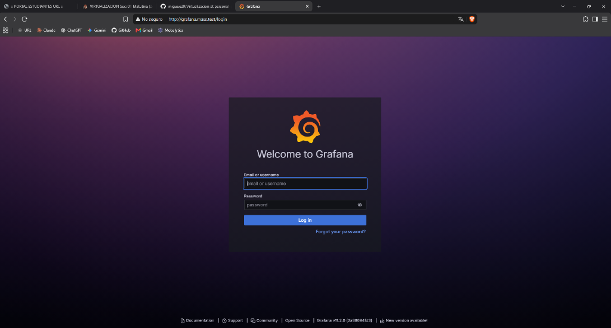
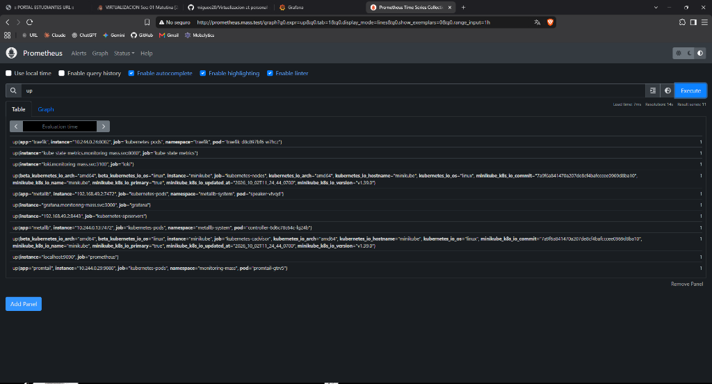
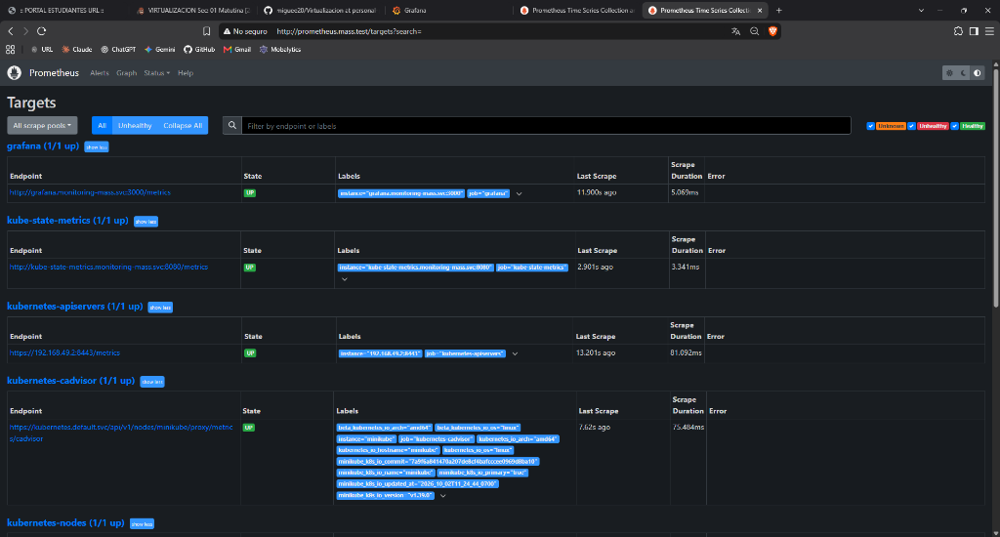
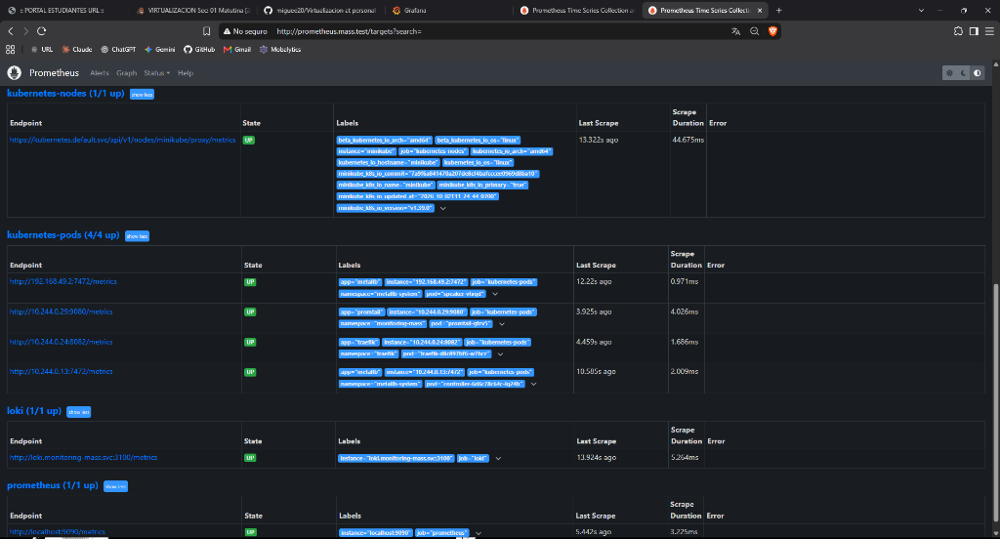
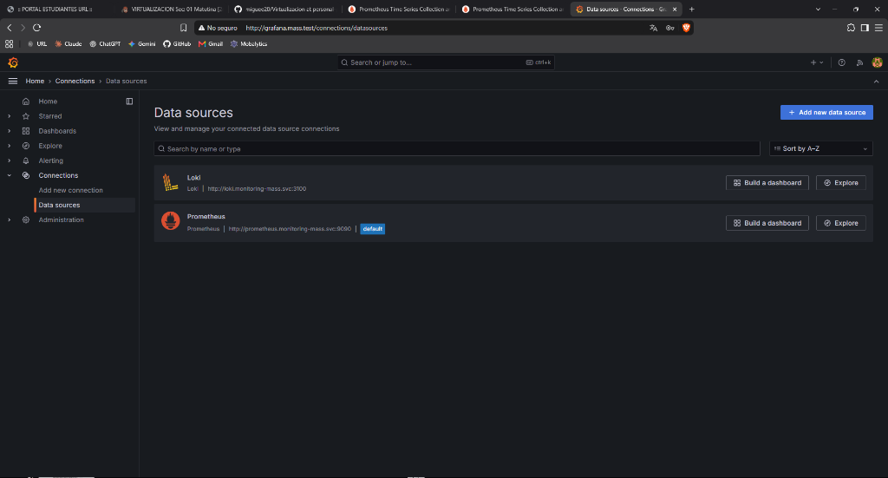
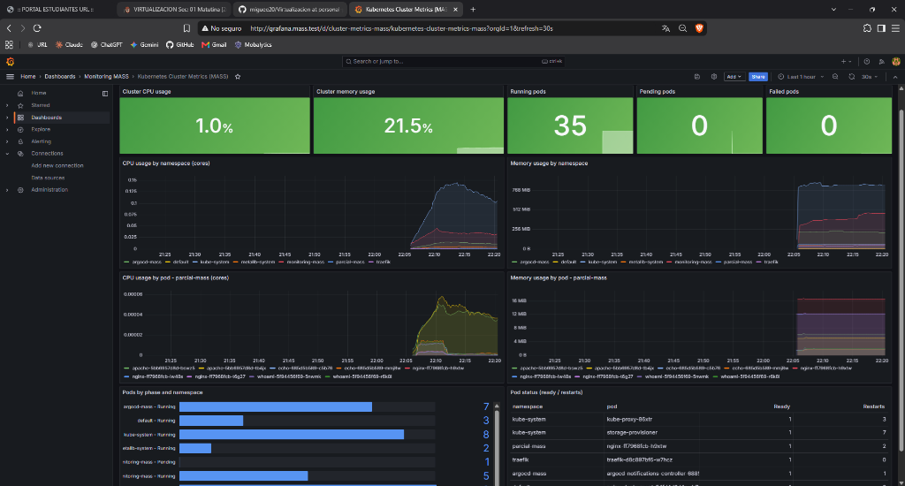
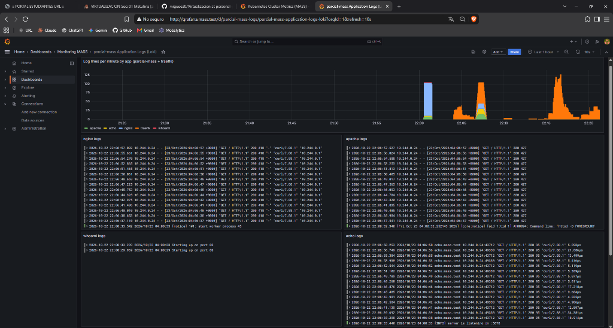

# Personal Project I - Monitoring and Logging in Kubernetes

**Student:** Miguel Antonio Salguero Sandoval (`mass`)

In this project I set up a monitoring and log collection stack inside my Minikube cluster using **Prometheus**, **Loki**, **Promtail** and **Grafana**. It runs on top of the cluster from the previous assessments (MetalLB + Traefik + the 4 apps in `parcial-mass`), with everything installed in the `monitoring-mass` namespace and exposed through Traefik at `http://grafana.mass.test` and `http://prometheus.mass.test`.

## Environment and Setup

- **OS:** Windows 11 Home (Minikube with the Docker driver)
- **Traefik LoadBalancer IP (MetalLB):** `192.168.49.200`
- **Monitoring namespace:** `monitoring-mass`
- **Apps namespace:** `parcial-mass` (`nginx`, `apache`, `whoami`, `echo`)
- **Domains:** `grafana.mass.test`, `prometheus.mass.test`

Instead of using Helm, I wrote all the configurations as plain Kubernetes YAML manifests and grouped them with a `kustomization.yaml` file so the whole stack can be applied with a single command.

## Repository layout

- `metallb/` - MetalLB installation and IP pool (`192.168.49.200/32`)
- `traefik/` - Traefik deployment, RBAC and LoadBalancer service (updated to expose Prometheus metrics and access logs)
- `apps/` - the 4 web applications in `parcial-mass` (`nginx`, `apache`, `whoami` and `echo`) and their Ingress rules
- `monitoring/`
  - `kustomization.yaml` - deploys the whole monitoring stack and generates the ConfigMap for the dashboard JSON files
  - `namespace.yaml` - creates the `monitoring-mass` namespace
  - `prometheus/` - ServiceAccount, ClusterRole, `prometheus.yml` ConfigMap, Deployment, Service and Ingress
  - `kube-state-metrics/` - ServiceAccount, ClusterRole, Deployment and Service so Prometheus can read pod statuses
  - `loki/` - ConfigMap, Deployment and Service for log storage
  - `promtail/` - ServiceAccount, ClusterRole, ConfigMap and DaemonSet to ship container logs to Loki
  - `grafana/` - admin Secret, data source and dashboard provisioning ConfigMaps, Deployment, Service, Ingress and the 2 dashboard JSON files (`dashboards/`)
- `images/` - screenshots

---

## Step 1 - Start the cluster and base services

```powershell
minikube start --driver=docker
kubectl apply -f metallb/01-metallb-native.yaml
kubectl apply -f metallb/02-ipaddresspool.yaml
kubectl apply -f traefik/
kubectl apply -f apps/web/
kubectl apply -f apps/tools/
```

In `traefik/03-deployment.yaml`, I made sure `--accesslog=true` is enabled so Traefik prints every HTTP request to stdout, and I added `--metrics.prometheus=true` on port `8082` (plus the `prometheus.io/scrape: "true"` pod annotations) so Prometheus can scrape Traefik too.

## Step 2 - Deploy the monitoring stack in `monitoring-mass`

Everything under `monitoring/` is applied with Kustomize:

```powershell
kubectl apply -k monitoring/
kubectl wait --for=condition=ready pod --all -n monitoring-mass --timeout=300s
kubectl get pods -n monitoring-mass
```

---

## Step 3 - Prometheus configuration

**Folder:** `monitoring/prometheus/` and `monitoring/kube-state-metrics/`

Prometheus (`prom/prometheus:v2.54.1`) runs as a Deployment with a `ServiceAccount` and `ClusterRole` that give it read access to nodes, pods, endpoints and `/metrics` endpoints across the cluster.

In `monitoring/prometheus/configmap.yaml`, I configured the scrape jobs so Prometheus collects metrics from the cluster and the monitoring components:

- `prometheus` - scrapes Prometheus itself (`localhost:9090`).
- `kubernetes-apiservers` - metrics from the Kubernetes API server.
- `kubernetes-nodes` - kubelet metrics from the Minikube node (proxied through the API server).
- `kubernetes-cadvisor` - container CPU and memory metrics from cAdvisor.
- `kube-state-metrics` - scrapes `kube-state-metrics` on port `8080`, which I deployed in the same namespace so Grafana can show the state of the pods (Running, Pending, Failed, ready status and restarts).
- `loki` and `grafana` - metrics from Loki (`:3100`) and Grafana (`:3000`).
- `kubernetes-pods` - discovers any pod in the cluster with the annotation `prometheus.io/scrape: "true"` (Traefik, Promtail and MetalLB).

---

## Step 4 - Loki configuration

**File:** `monitoring/loki/loki.yaml`

Loki (`grafana/loki:2.9.10`) is deployed as a single-instance Deployment exposed inside the cluster on port `3100`. Its configuration (`loki-config` ConfigMap) disables multi-tenant auth (`auth_enabled: false`), uses the `tsdb` schema (v12), and stores chunks and indexes in the container filesystem under `/loki` with a 72-hour retention limit.

---

## Step 5 - Promtail configuration (DaemonSet)

**File:** `monitoring/promtail/promtail.yaml`

Promtail (`grafana/promtail:2.9.10`) is deployed as a **DaemonSet** so an instance runs on every node in the cluster. It has a `ServiceAccount` and `ClusterRole` to query the Kubernetes API for pods, and it mounts `/var/log/pods` (read-only) from the Minikube node, which is where containerd stores all container logs.

How the log collection works in `promtail-config`:

1. It uses `kubernetes_sd_configs` (`role: pod`) to discover all pods in the cluster, including the 4 applications in `parcial-mass` (`nginx`, `apache`, `whoami`, `echo`) and `traefik`.
2. It uses the `cri` pipeline stage (`- cri: {}`) because Minikube with Docker uses containerd, which writes logs in CRI format.
3. With `relabel_configs`, it keeps only the pods running on the current node and attaches useful Kubernetes metadata as Loki labels: `namespace`, `pod`, `container`, `app`, `node` and `job`.
4. It resolves each container's log file path to `/var/log/pods/*<pod_uid>/<container>/*.log` and pushes the log streams to `http://loki.monitoring-mass.svc:3100/loki/api/v1/push`.

---

## Step 6 - Grafana: Data sources and Dashboards as code

**Folder:** `monitoring/grafana/`

Grafana (`grafana/grafana:11.2.0`) runs with the admin user and password stored in the `grafana-admin` Secret (`admin` / `admin123`). Both the data sources and the dashboards are provisioned automatically from ConfigMaps when the pod starts, without touching the UI manually.

### Data sources provisioning

In `monitoring/grafana/provisioning.yaml`, the `grafana-datasources` ConfigMap is mounted into `/etc/grafana/provisioning/datasources/datasources.yaml`:

```yaml
apiVersion: 1
datasources:
  - name: Prometheus
    uid: prometheus
    type: prometheus
    access: proxy
    url: http://prometheus.monitoring-mass.svc:9090
    isDefault: true
    editable: false
  - name: Loki
    uid: loki
    type: loki
    access: proxy
    url: http://loki.monitoring-mass.svc:3100
    editable: false
```

### Dashboards provisioning

The `grafana-dashboard-provider` ConfigMap is mounted into `/etc/grafana/provisioning/dashboards/dashboards.yaml` and tells Grafana to load all JSON files from `/var/lib/grafana-dashboards`. Kustomize packages the two JSON files from `monitoring/grafana/dashboards/` into the `grafana-dashboards` ConfigMap:

1. **`cluster-metrics.json` - Kubernetes Cluster Metrics (MASS):**
   Queries Prometheus (`container_cpu_usage_seconds_total`, `container_memory_working_set_bytes`, `kube_pod_status_phase`, `kube_pod_status_ready`, `kube_pod_container_status_restarts_total`) to show:
   - Total cluster CPU and memory usage (%)
   - Number of Running, Pending and Failed pods
   - CPU and memory usage broken down by namespace and by pod in `parcial-mass`
   - Pods by phase and a table with Ready status and restarts for each pod
2. **`parcial-mass-logs.json` - parcial-mass Application Logs (Loki):**
   Queries Loki to show:
   - A bar chart with log lines per minute by app (`parcial-mass` and `traefik`)
   - Separate log panels for each of the 4 apps in `parcial-mass`:
     - `{namespace="parcial-mass", app="nginx"}`
     - `{namespace="parcial-mass", app="apache"}`
     - `{namespace="parcial-mass", app="whoami"}`
     - `{namespace="parcial-mass", app="echo"}`
   - A log panel for Traefik access logs (`{namespace="traefik"}`)

---

## Step 7 - Exposing Grafana and Prometheus with Traefik and DNS

Grafana and Prometheus each have an `Ingress` resource in `monitoring-mass` with `ingressClassName: traefik`:

- `grafana.mass.test` -> `grafana:3000`
- `prometheus.mass.test` -> `prometheus:9090`

```powershell
kubectl get ingress -n monitoring-mass
```

### Local DNS (`hosts` file)

In `Assessment II` my domain was `mass.test`, so I added `grafana.mass.test` and `prometheus.mass.test` to `C:\Windows\System32\drivers\etc\hosts` (running PowerShell as Administrator).

As in the previous assessments, because Minikube runs inside Docker on Windows 11 Home, Windows cannot route directly to the MetalLB IP (`192.168.49.200`), so `minikube tunnel` bridges the Traefik LoadBalancer to `127.0.0.1` (on Linux, the hosts file would use `192.168.49.200` directly):

```powershell
Add-Content C:\Windows\System32\drivers\etc\hosts "`n127.0.0.1 grafana.mass.test`n127.0.0.1 prometheus.mass.test"
ipconfig /flushdns
minikube tunnel   # leave open in an Administrator PowerShell window
```

To generate log entries across all 4 apps in `parcial-mass` and Traefik:

```powershell
1..15 | ForEach-Object {
  foreach ($h in "nginx","apache","whoami","echo") {
    minikube ssh -- "curl -s -o /dev/null -H 'Host: $h.mass.test' http://192.168.49.200/"
  }
}
```

---

## Screenshots

### 1. Accessing Grafana via `http://grafana.mass.test`



### 2. Accessing Prometheus via `http://prometheus.mass.test`



### 3. Prometheus Targets (all UP)





### 4. Provisioned Data Sources in Grafana



### 5. Cluster Metrics Dashboard (CPU, Memory, Pod Status)



### 6. Application Logs Dashboard (`nginx`, `apache`, `whoami`, `echo` and `traefik`)


